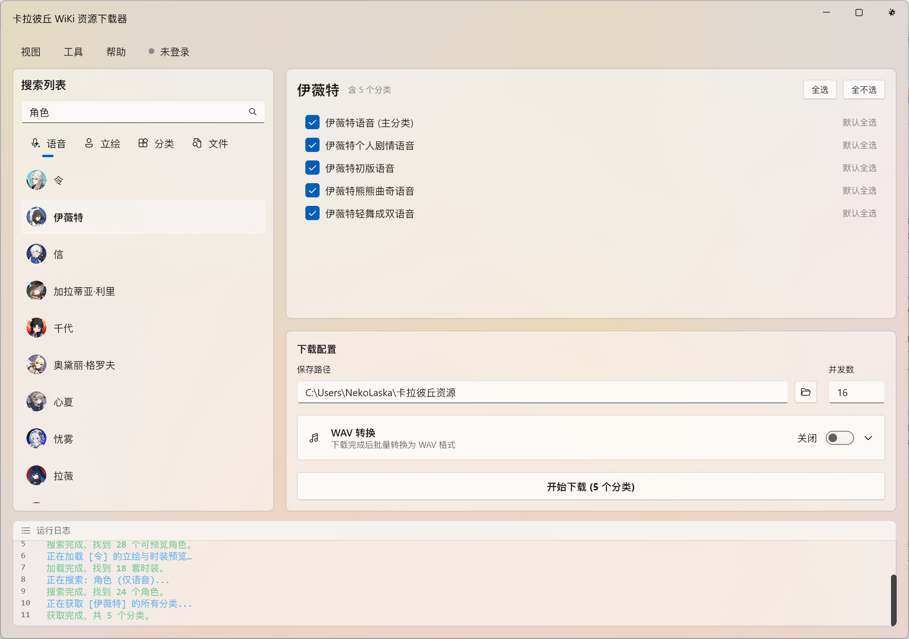
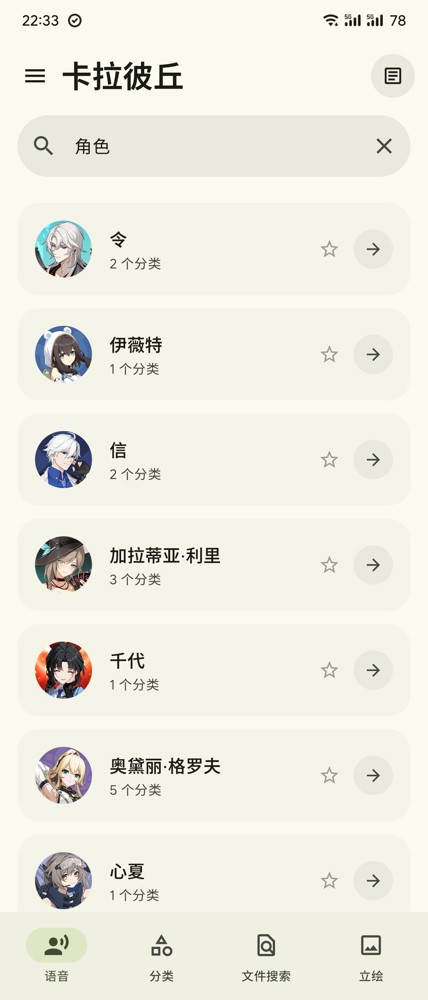

<div align="center">

# 🌌 CalabiYauVoice GUI


[](https://github.com/JetBrains/compose-multiplatform)

[](LICENSE.txt)

A Kotlin Multiplatform [Strinova](https://wiki.biligame.com/klbq/) Wiki resource browser & downloader, built with Compose for Desktop and Android.

[](https://wiki.nekolaska.vip/)
[](https://wiki.nekolaska.vip/nav/)
[](https://wiki.nekolaska.vip/search)

**Website:** [wiki.nekolaska.vip](https://wiki.nekolaska.vip/)  
**Backup:** [calabiyauwiki.pages.dev](https://calabiyauwiki.pages.dev/)

[简体中文](README_ZH_CN.md) · [Project documentation](docs/README.md) · [Release notes](docs/README.md#发布记录)

<br>

<table>
  <tr>
    <th>Desktop</th>
    <th>Android</th>
  </tr>
  <tr>
    <td></td>
    <td></td>
  </tr>
</table>

</div>

---

## ✨ Features

### 🤝 Shared (Both Platforms)

- **🔍 Smart Search** — 4 search modes: voice-only categories, all resource types, file search (namespace 6), and portrait/illustration.
- **⚡ Concurrent Downloads** — Scan category trees and download files with configurable concurrency.
- **🎵 Audio Playback** — In-app playback for `WAV`, `OGG`, `FLAC`, and `MP3` files.
- **🖼️ Rich Preview** — Live image previews for `PNG`, `JPG`, `WebP`, and animated `GIF`.
- **🗂️ File Selection Dialog** — Per-category file picker with search, language filtering (CN/JP/EN), and image preview.

### 🖥️ Desktop Extras (Windows)

- **🔄 Audio → WAV Conversion** — Batch-convert `MP3`, `FLAC`, `OGG`, `AAC`, and `M4A` files to WAV with configurable sample rate, bit depth, dithering, and optional WAV merging.
- **🧰 Asset Workbench** — Process images and subtitle timelines, or edit audio with silence trimming, channel conversion, gain/normalization, noise gate, fades, phase tools, undo/redo, and spectrogram preview/export.
- **⌨️ Keyboard Shortcuts** — `Ctrl+F` focus search, `F5` re-search, `Ctrl+D` download, `Ctrl+A` / `Ctrl+Shift+A` select / deselect all, `Ctrl+1~4` switch modes, `↑↓` navigate, and more.
- **🎛️ Windows Backdrop** — Switch between Mica, Tabbed, Acrylic, Aero, and other Windows 11 backdrop styles at runtime.
- **🪟 Custom Title Bar** — Borderless native window with custom caption buttons and drag-to-move support.
- **🖥️ Compatibility** — Graceful fallback on non-Windows-11 devices with gradient background.

### 📱 Android Extras

- **🏠 Wiki Home** — Search the Wiki, open the full directory, or jump to balance stats and the weapon list. Switch between character and map previews without losing either filter or scroll position. Costumes, decorations, and voting have native pages; full announcements, event articles, and stories open in the built-in Wiki browser.
- **🎛️ Six home shortcuts** — Open **Edit** on the home page or **Home shortcuts** in Settings. Search for an entry, replace or reorder shortcuts, and choose a grid or button layout. Changes take effect when you save. [Home and settings navigation](docs/android-navigation-followup.md)
- **🧭 Extraction mode (弦溯战线)** — Open the hub from Wiki Home to look up drops by item or source, browse supplies and attachments, compare firearm and armor quality tiers, or find workshop recipes by ingredient. The full drop table opens in the Wiki browser. [Extraction guide](docs/extraction-mode-implementation.md)
- **📖 Guides** — Native PC game settings, beginner guide, Stringification, character roles, and augmentation network pages with section navigation and offline reading.
- **🖼️ Gallery** — Browse wallpapers, stickers, and comics in a native image gallery with section filtering and fullscreen preview.
- **🌐 Built-in Wiki Browser** — Embedded WebView with cookie persistence, auto-login detection, user info display, and file download/upload support.
- **👤 Custom User Profile** — Sign in with your Wiki account to set a custom nickname, avatar (auto-compressed to WebP), badge, and bio; displayed on the sidebar and user sheet, with official info as fallback.
- **🖼️ Portrait Viewer** — Swipeable multi-image preview per costume with image type labels and page indicators.
- **📁 File Manager** — Browse downloaded files with multi-select mode (long-press), batch delete/share, image gallery preview, and audio playback.
- **🧰 Asset Tools** — Convert, crop and stitch images, process GIFs, or edit audio, subtitles and video. Privacy-cleaned image copies are exported after EXIF cleanup; a failed audio import preserves the previous edit and undo history.
- **📊 Download History** — Track past downloads with status and file count.
- **⭐ Favorites** — Bookmark characters for quick access.
- **💾 Offline Cache** — Disk cache for Wiki resources with offline-first mode, cache pruning, and manual cache clearing.
- **🎨 Material You** — Dynamic color with wallpaper-based seed color, light/dark/system theme, and liquid glass effects.
- **💬 Message Board** — Two-level discussions with reply notifications, pinned threads, admin moderation, per-account draft isolation, and rename-stable identity.
- **🔎 Character and Weapon Details** — Browse character skills, relationships, and signature weapons. The 伏闪 sniper rifle page includes a zoomable firing timeline, Demolition-mode upgrades, and individual links to its five users.
- **⬇️ In-App Updates** — Release-site update checker with changelog and one-tap APK download.
- **Usage statistics and privacy** — Since 2.2.4, the Android app sends daily per-installation counters to the project's own service. Reports exclude Wiki accounts, filenames, subtitle text, and vote choices. This is enabled by default and can be turned off in Settings → Privacy. [Data and retention](docs/app-usage.md)

---

## 🛠️ Tech Stack

### Shared (commonMain)

| Component     | Technology                   |
|---------------|------------------------------|
| Language      | Kotlin                       |
| Async         | Kotlin Coroutines            |
| Network       | OkHttp + Okio                |
| Serialization | kotlinx.serialization JSON   |

Exact versions are maintained in [`gradle/libs.versions.toml`](gradle/libs.versions.toml). `shared` contains JVM/Android business and media code, without Compose UI dependencies; it is not an iOS/JS implementation. Compose UI belongs to the platform application modules.

### Desktop

| Component | Technology                                                                                                                                         |
|-----------|----------------------------------------------------------------------------------------------------------------------------------------------------|
| UI        | [Compose Fluent UI](https://github.com/NucleusFramework/compose-fluent-ui), [ComposeWindowStyler](https://github.com/mayakapps/compose-window-styler) |
| Audio     | Java Sound SPI (`MP3` / `OGG` / `AAC` / `M4A`), official `libFLAC` 1.5.0 via JNA                                                                   |
| Image     | `javax.imageio.ImageIO` (GIF frame decoding)                                                                                                       |
| Native    | JNA 5.19.1 (Windows API and native FLAC decoding)                                                                                                  |

### Android

| Component     | Technology                   |
|---------------|------------------------------|
| UI            | Jetpack Compose + Material 3 |
| Image Loading | Coil (async + GIF)           |
| Web           | Android WebView              |
| Audio         | Android MediaPlayer          |
| Architecture  | ViewModel/StateFlow for downloads; LoadState and feature state holders for Wiki pages |
| Min SDK       | Android 7.1 (API 25)         |

### Download Page (`downloadPage/`)

| Component   | Technology                                      |
|-------------|-------------------------------------------------|
| Framework   | Svelte 5 + TypeScript                           |
| Bundler     | Vite 8                                          |
| Package mgr | pnpm workspace                                  |
| Hosting     | Cloudflare Pages                                |
| Edge API    | Cloudflare Worker (`src/api/_worker.js`)        |
| Storage     | D1 for accounts, the message board and separate usage counters; R2 for avatars and APKs |
| Libraries   | `jszip` (batch export)                          |
| Pages       | Home / Download / Wiki Search / Wiki Navigation / Admin console |

---

## 📂 Project Structure

| Directory | What lives here |
| --- | --- |
| [`androidApp/`](androidApp/) | Native Wiki pages, Android downloads, tools and settings. See the [architecture guide](docs/android-architecture.md) for module ownership. |
| [`desktopApp/`](desktopApp/) | Windows UI, media tooling and native integrations. See the [desktop guide](docs/desktop-implementation-guide.md). |
| [`shared/`](shared/) | Wiki queries, download coordination, models and media code shared by both apps. |
| [`downloadPage/`](downloadPage/) | Production download site, browser tools, Pages Worker and D1 migrations. [Backend guide](docs/user-system-backend.md) |
| [`webApp/`](webApp/README.md) | Archived Compose Web demo; excluded from default builds. |

## 🚀 Build and Run

Developer documentation: [documentation index](docs/README.md), [Android architecture](docs/android-architecture.md), [release procedure](docs/release-version-checklist.md). Published metadata is in [`latest.json`](downloadPage/downloads/latest.json); APKs are stored in R2, not Git.

### Requirements

- JDK 21 (the Gradle toolchain can provision the configured Amazon Corretto JDK)
- Android SDK for Android builds
- Node.js and pnpm for `downloadPage/`
- Windows x64 for desktop FLAC playback/conversion; the official `libFLAC.dll` 1.5.0 is bundled and verified by SHA-256 before loading

```powershell
# Build the project
./gradlew.bat build

# Run Desktop app
./gradlew.bat run

# Build Android APK
./gradlew.bat assembleDebug

# Download page (web tools)
cd downloadPage
pnpm install
pnpm dev
pnpm build
```

> For macOS/Linux, use `./gradlew` instead of `./gradlew.bat`.

### Archived Compose Web prototype

`webApp/` is an **unmaintained UI prototype**, not the production website or a working
downloader. It uses sample data and simulated progress. Normal Gradle builds exclude it;
optional experiments require `-PincludeArchivedWebApp=true`.
See [`webApp/README.md`](webApp/README.md). Active browser features are maintained in `downloadPage/`.

## ⚠️ Notes

- 📡 **API Dependency:** The app depends on Bilibili wiki endpoints; availability may vary depending on network conditions.
- 📱 **Android:** Requires Android 7.1 (API 25) or later.
- 🖥️ **Desktop FLAC:** Native FLAC decoding currently supports Windows x64. Packaged desktop distributions include the required DLL and third-party notices.
- 🌐 **Website:** Prefer [wiki.nekolaska.vip](https://wiki.nekolaska.vip/); [calabiyauwiki.pages.dev](https://calabiyauwiki.pages.dev/) is the Cloudflare Pages backup.

## 📄 License

See [LICENSE.txt](LICENSE.txt) for more information.
