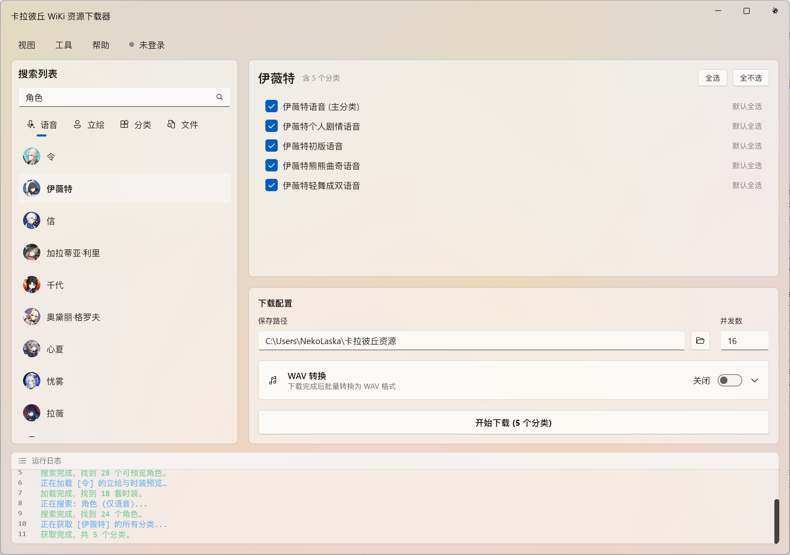

<div align="center">

# 🌌 CalabiYauVoice GUI


[](https://github.com/JetBrains/compose-multiplatform)

[](LICENSE.txt)

基于 Kotlin Multiplatform 构建的[卡拉彼丘](https://wiki.biligame.com/klbq/) Wiki 资源浏览与下载工具，支持桌面端和 Android 端。

[](https://wiki.nekolaska.vip/)
[](https://wiki.nekolaska.vip/nav/)
[](https://wiki.nekolaska.vip/search)

**官网入口：** [wiki.nekolaska.vip](https://wiki.nekolaska.vip/)  
**备用链接：** [calabiyauwiki.pages.dev](https://calabiyauwiki.pages.dev/)

[English](README.md) · [项目文档](docs/README.md) · [发布记录](docs/README.md#发布记录)

<br>

<table>
  <tr>
    <th>桌面端</th>
    <th>Android 端</th>
  </tr>
  <tr>
    <td></td>
    <td></td>
  </tr>
</table>

</div>

---

## ✨ 功能特性

### 🤝 共享功能（双端通用）

- **🔍 智能搜索** — 四种搜索模式：仅语音分类、全部分类、文件搜索（命名空间 6）、立绘预览。
- **⚡ 并发下载** — 扫描分类树并并发下载文件，支持自定义并发数。
- **🎵 音频播放** — 支持播放 `WAV`、`OGG`、`FLAC`、`MP3` 格式音频。
- **🖼️ 丰富预览** — 支持 `PNG`、`JPG`、`WebP` 静态图与 `GIF` 逐帧动画预览。
- **🗂️ 文件选择对话框** — 按分类浏览文件，支持搜索、语言筛选（中/日/英）与图片预览。

### 🖥️ 桌面端增强（Windows）

- **🔄 音频转 WAV** — 批量将 `MP3`、`FLAC`、`OGG`、`AAC`、`M4A` 转换为 WAV，支持自定义采样率、位深、抖动处理与可选 WAV 合并。
- **🧰 素材工作库** — 集中处理图片和字幕时间轴；音频工具支持静音裁剪、声道转换、增益/标准化、噪声门、淡入淡出、相位处理、撤销/重做以及频谱图预览与导出。
- **⌨️ 键盘快捷键** — `Ctrl+F` 聚焦搜索，`F5` 重新搜索，`Ctrl+D` 开始下载，`Ctrl+A` / `Ctrl+Shift+A` 全选 / 取消全选，`Ctrl+1~4` 切换模式，`↑↓` 导航列表等。
- **🎛️ 窗口特效** — 运行时动态切换 Mica、Tabbed、Acrylic、Aero 等 Windows 11 背景特效。
- **🪟 自定义标题栏** — 无边框原生窗口，自定义标题栏按钮，支持拖拽移动。
- **🖥️ 兼容性** — 非 Windows 11 设备自动降级，使用渐变背景保证可读性。

### 📱 Android 端增强

- **🏠 Wiki 首页** — 可直接搜索、打开完整导航，或查看平衡数据和武器一览。角色与地图共用预览区，切换时各自保留筛选和滚动位置。时装、玩家装饰和投票有原生页面；公告、活动和剧情的完整文章在内置 Wiki 浏览器打开。
- **🎛️ 六个首页快捷入口** — 从首页「我的快捷入口 → 编辑」或「设置 → 首页快捷入口」打开同一编辑器。可搜索、替换或调整六个入口的顺序，选择网格或按钮布局，保存后生效。[首页与设置导航](docs/android-navigation-followup.md)
- **🧭 弦溯战线** — 从 Wiki 首页进入专题，按物品或来源查询掉落、浏览物资和配件、对比枪械与防具的品质档，或按材料查工坊配方。「掉落表格」打开 Wiki 原文。[弦溯专题说明](docs/extraction-mode-implementation.md)
- **📖 实用指南与玩法资料** — PC 游戏设置、新人入坑指南、弦化、超弦体定位和弦能增幅网络原生阅读，支持章节切换与离线资料。
- **🖼️ 画廊** — 原生浏览壁纸、表情包、四格漫画，支持分区筛选与全屏预览。
- **🌐 内置 Wiki 浏览器** — 嵌入式 WebView，支持 Cookie 持久化、自动检测登录状态、用户信息展示、文件下载/上传与页面导航。
- **👤 自定义用户档案** — 登录 Wiki 账号后可设置自定义昵称、头像（自动压缩为 WebP）、称号与签名，展示在侧栏与用户信息弹窗中，未设置时回退官方信息。
- **🖼️ 立绘查看器** — 多时装切换，每套时装支持横向滑动浏览全部图片，显示图片类型标签与页码指示器。
- **📁 文件管理器** — 浏览已下载文件，支持多选模式（长按进入）、批量删除/分享、图片画廊预览与音频播放。
- **🧰 素材工具** — 图片转换、裁切、拼图和 GIF 处理，以及音频、字幕和视频工具。EXIF 隐私字段清理后才导出图片副本；新音频导入失败时保留已有编辑和撤销记录。
- **📊 下载历史** — 记录历史下载，显示状态与文件数。
- **⭐ 收藏功能** — 收藏常用角色，方便快速访问。
- **💾 离线缓存** — Wiki 资源磁盘缓存，支持优先缓存模式、过期清理与手动清空缓存。
- **🎨 Material You** — 支持动态取色与壁纸跟随主题色，亮色/暗色/跟随系统，液态玻璃效果。
- **💬 留言板** — 两层回复讨论，支持回复通知、置顶与管理审核，草稿按账号隔离，改名后身份保持稳定。
- **🔎 角色与武器详情** — 查看角色技能、关系和专属武器。伏闪详情提供可缩放的开火时间轴、分组的爆破模式增幅，以及五位使用者的独立入口。
- **⬇️ 应用内更新** — 对接发布站检查新版本，展示更新日志并一键下载 APK。
- **使用统计与隐私** — 2.2.4 起，客户端向自有服务上报按安装汇总的每日计数，不含 Wiki 账号、文件名、字幕或投票对象。默认开启，可在「设置 → 隐私 → 匿名使用统计」关闭。[数据范围与保留时间](docs/app-usage.md)

---

## 🛠️ 技术栈

### 共享层（commonMain）

| 组件    | 技术                           |
|-------|------------------------------|
| 语言    | Kotlin                       |
| 异步    | Kotlin Coroutines            |
| 网络    | OkHttp + Okio                |
| 序列化   | kotlinx.serialization JSON   |

具体版本以 [`gradle/libs.versions.toml`](gradle/libs.versions.toml) 为准。`shared` 共享 JVM/Android 业务与媒体代码，不依赖 Compose UI，也不代表已有 iOS/JS 实现；界面依赖由各应用模块持有。

### 桌面端

| 组件    | 技术                                                                                                                                                |
|-------|---------------------------------------------------------------------------------------------------------------------------------------------------|
| UI 框架 | [Compose Fluent UI](https://github.com/NucleusFramework/compose-fluent-ui)、[ComposeWindowStyler](https://github.com/mayakapps/compose-window-styler) |
| 音频    | Java Sound SPI（`MP3` / `OGG` / `AAC` / `M4A`）、通过 JNA 接入的官方 `libFLAC` 1.5.0                                                               |
| 图像    | `javax.imageio.ImageIO`（GIF 多帧解码）                                                                                                                 |
| 原生调用  | JNA 5.19.1（Windows API 与原生 FLAC 解码）                                                                                                               |

### Android 端

| 组件    | 技术                           |
|-------|------------------------------|
| UI 框架 | Jetpack Compose + Material 3 |
| 图片加载  | Coil（异步加载 + GIF 支持）      |
| 网页    | Android WebView              |
| 音频    | Android MediaPlayer          |
| 架构    | 下载使用 ViewModel/StateFlow；Wiki 使用 LoadState 和功能状态类 |
| 最低系统  | Android 7.1（API 25）         |

### 下载页 / 网页工具站（`downloadPage/`）

| 组件    | 技术                                      |
|-------|-----------------------------------------|
| 前端框架  | Svelte 5 + TypeScript                   |
| 构建工具  | Vite 8                                  |
| 包管理    | pnpm workspace                            |
| 部署    | Cloudflare Pages                        |
| 边缘接口  | Cloudflare Worker（`src/api/_worker.js`） |
| 存储    | D1（账号、留言及独立的使用统计表）；R2（头像、APK） |
| 依赖库    | `jszip`（批量导出）                        |
| 页面    | 首页 / 下载 / Wiki 搜索 / Wiki 导航 / 管理后台           |

---

## 📂 项目结构

| 目录 | 职责 |
| --- | --- |
| [`androidApp/`](androidApp/) | 原生 Wiki、资源下载、工具与设置。模块归属见 [Android 架构](docs/android-architecture.md)。 |
| [`desktopApp/`](desktopApp/) | Windows 窗口、素材工具及原生接口。见[桌面实现说明](docs/desktop-implementation-guide.md)。 |
| [`shared/`](shared/) | 双端共用的 Wiki 查询、下载编排、模型与媒体处理。 |
| [`downloadPage/`](downloadPage/) | 生产下载站、网页工具、Pages Worker 与 D1 迁移。见[后端说明](docs/user-system-backend.md)。 |
| [`webApp/`](webApp/README.md) | 已归档的 Compose Web 演示，默认不参与构建。 |

## 🚀 构建与运行

开发文档：[文档索引](docs/README.md)、[Android 当前架构](docs/android-architecture.md)、[版本发布流程](docs/release-version-checklist.md)。线上版本信息见 [`latest.json`](downloadPage/downloads/latest.json)，APK 存储在 R2，不纳入 Git。

### 环境要求

- JDK 21（Gradle toolchain 可自动配置项目指定的 Amazon Corretto JDK）
- 构建 Android 应用时需要 Android SDK
- 构建 `downloadPage/` 时需要 Node.js 与 pnpm
- 桌面端 FLAC 播放/转换目前需要 Windows x64；项目已内置官方 `libFLAC.dll` 1.5.0，并在加载前校验 SHA-256

```powershell
# 构建项目
./gradlew.bat build

# 运行桌面应用
./gradlew.bat run

# 构建 Android APK
./gradlew.bat assembleDebug

# 下载页 / 网页工具站
cd downloadPage
pnpm install
pnpm dev
pnpm build
```

> macOS / Linux 请使用 `./gradlew` 代替 `./gradlew.bat`。

### 已归档的 Compose Web 原型

`webApp/` 已停止维护，**不是正式网页客户端，也不是可用的下载器**：数据与下载进度均为演示。
默认 Gradle 构建不包含此模块；仅实验时通过 `-PincludeArchivedWebApp=true` 显式启用。
详见 [`webApp/README.md`](webApp/README.md)。正式浏览器功能继续维护在 `downloadPage/` 中。

## ⚠️ 注意事项

- 📡 **API 依赖：** 本应用依赖 Bilibili Wiki 的 API 接口，可用性可能受网络环境影响。
- 📱 **Android：** 需要 Android 7.1（API 25）或更高版本。
- 🖥️ **桌面端 FLAC：** 原生 FLAC 解码目前支持 Windows x64；桌面发行包已包含所需 DLL 与第三方许可声明。
- 🌐 **网站入口：** 请优先访问 [wiki.nekolaska.vip](https://wiki.nekolaska.vip/)；[calabiyauwiki.pages.dev](https://calabiyauwiki.pages.dev/) 为 Cloudflare Pages 备用链接。

## 📄 许可证

详见 [LICENSE.txt](LICENSE.txt)。
